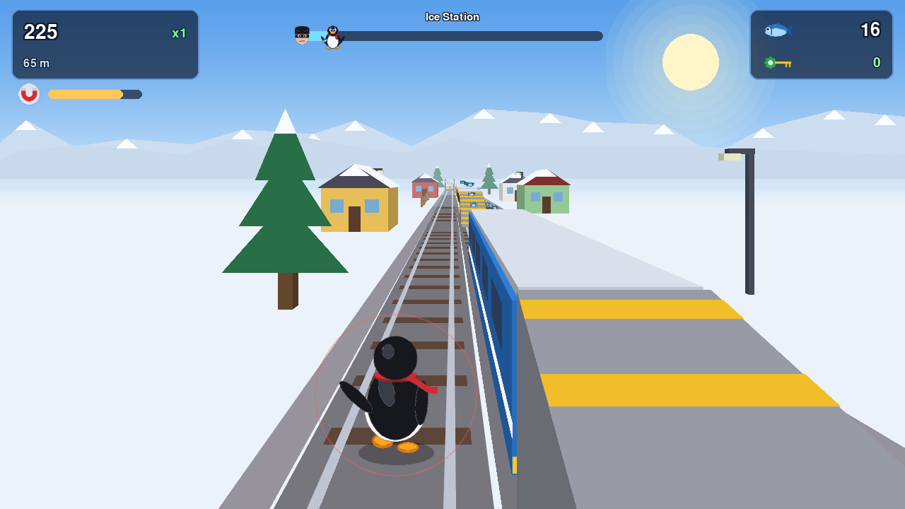

# Tux Train Surfer

[](https://github.com/on8svh/tux-train-surfer/actions/workflows/ci.yml)
[](https://github.com/on8svh/tux-train-surfer/actions/workflows/snap.yml)
[](https://snapcraft.io/tux-train-surfer)
[](LICENSE)

**Outrun the bugs, surf the trains, grab the fish!**

Tux Train Surfer is a free and open source three-track runner starring Tux, the Linux penguin.
Something nasty is chasing Tux: a thief, a **Kernel Panic**, a **Segfault Monster** or a
**Proprietary Lock-in**. Switch tracks, jump over firewalls and onto trains, duck and roll under
network cables, dodge zombie processes, and watch out for slippery ice where Tux can't steer.



## Features

- **15 levels in 15 worlds**: Ice Station, Antarctic Plains, Iceland Geysers, Container Marathon,
  Server Rack Tunnel (with blinking LEDs), Terminal Railway (data streams instead of rails),
  Northern Lights and more. There's also an **endless mode** that cycles through every world.
- **Trains** that stand still or drive towards you (listen for the horn!), with ramps up to the roofs.
- **Obstacles**: firewalls (jump), hanging cables (duck or roll), zombie processes walking across
  the tracks, and ice where Tux slides and can't steer, jump or duck.
- **Pickups**: fish (10 points), golden fish (worth 5 fish) and open-source keys (50 points).
- **Power-ups**: magnet, Tux-board (survives one hit), jetpack (fly over everything),
  super jump and coffee (score x2).
- **Missions**: three at a time, such as "Roll under 10 cables" or "Collect 50 fish in one run".
  Completing a set raises your permanent **score multiplier**.
- **Skins**: Classic, Winter Hat, Sysadmin, Retro 90s and Container Captain Tux. You unlock them
  by collecting fish.
- **26 languages**, picked automatically from your operating system and changeable in Settings.
- **Remappable controls** for keyboard and gamepad, in the Controls menu. Touch and mouse swipes
  also work.
- **HD ready**: 1280×720, 1600×900, 1920×1080 or 2560×1440, windowed or fullscreen (F11).
  The automatic setting renders at 1280×720 and the GPU scales the image to your screen, which
  keeps 60 fps on ordinary laptops. Higher render resolutions in Settings need a faster CPU.

### Completely open source, graphics included

The game ships **no image or sound files**. Every image (Tux, the chasers, trains, worlds and
icons) and every sound effect and music loop is generated by the game's own Python code. The
whole game, art included, is under the [MIT licence](LICENSE).

Tux was originally created by Larry Ewing with The GIMP. The Tux in this game is a new,
code-drawn version of the penguin.

## Install

### Snap Store

```bash
sudo snap install tux-train-surfer
```

### From source (Linux, Windows, macOS)

You need Python 3.10 or newer.

```bash
git clone https://github.com/on8svh/tux-train-surfer.git
cd tux-train-surfer
python -m pip install .
tux-train-surfer
```

Or run it without installing: `pip install pygame` and then `python -m tux_train_surfer`.

## Controls (defaults, remappable)

| Action        | Keyboard          | Gamepad           |
|---------------|-------------------|-------------------|
| Move left     | ← / A             | D-pad / left stick|
| Move right    | → / D             | D-pad / left stick|
| Jump          | ↑ / W / Space     | A                 |
| Duck / roll   | ↓ / S             | B                 |
| Pause         | Esc / P           | Start             |
| Fullscreen    | F11 / Alt+Enter   |                   |

Pressing duck in the air makes Tux drop down fast.

## Command line options

```
tux-train-surfer [--fullscreen | --windowed] [--resolution 1920x1080] [--lang nl]
                 [--level N] [--start levels|missions|skins|settings|controls|help]
                 [--mute] [--autoplay] [--seed N]
```

Saves and settings are stored in `$SNAP_USER_DATA` (snap), `~/.local/share/tux-train-surfer`
(Linux), `%APPDATA%\TuxTrainSurfer` (Windows) or `~/Library/Application Support/TuxTrainSurfer` (macOS).

## Development

```bash
python -m pip install -e ".[dev]"
pytest            # unit tests + headless smoke tests of every screen
ruff check .
python -m tux_train_surfer --smoke-test 300 --level 9 --autoplay --screenshot shot.png
```

Project layout:

| File | What it does |
|------|--------------|
| `tux_train_surfer/world.py` | Physics, collisions, power-ups, track generator, autopilot (no pygame) |
| `tux_train_surfer/levels.py` | The 15 levels, their worlds (themes) and chasers |
| `tux_train_surfer/missions.py` | Mission sets and the score multiplier |
| `tux_train_surfer/render.py` | Pseudo-3D renderer |
| `tux_train_surfer/art.py` | All procedural artwork (Tux, skins, chasers, icons) |
| `tux_train_surfer/audio.py` | Synthesised sound effects and music |
| `tux_train_surfer/game.py` | Screens, menus, HUD, input mapping |
| `tux_train_surfer/locale/*.json` | Translations |

### Adding a language

Copy `tux_train_surfer/locale/en.json` to `<code>.json`, for example `eu.json`, and translate the
values. The game detects the file automatically. Keep placeholders such as `{n}` and `{chaser}`.
The current translations were machine-assisted, so native speakers are very welcome to improve
them. Scripts that need complex text shaping, such as Arabic, Hebrew and Hindi, aren't supported
by the text renderer yet.

## Publishing

See [PUBLISHING.md](PUBLISHING.md) for releasing to GitHub and the Snap Store.

## License

MIT, see [LICENSE](LICENSE). "Linux" is a registered trademark of Linus Torvalds. This game is a fan
project and isn't affiliated with any company.
